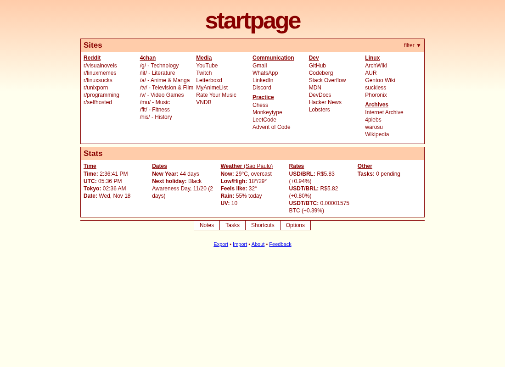
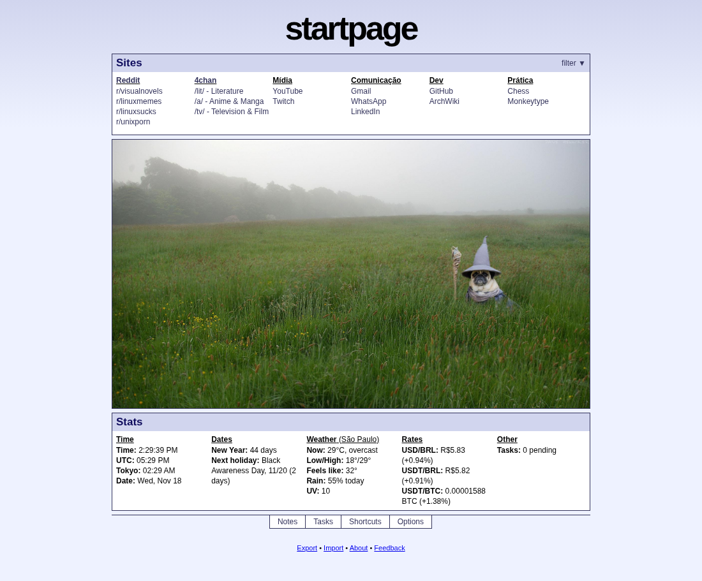
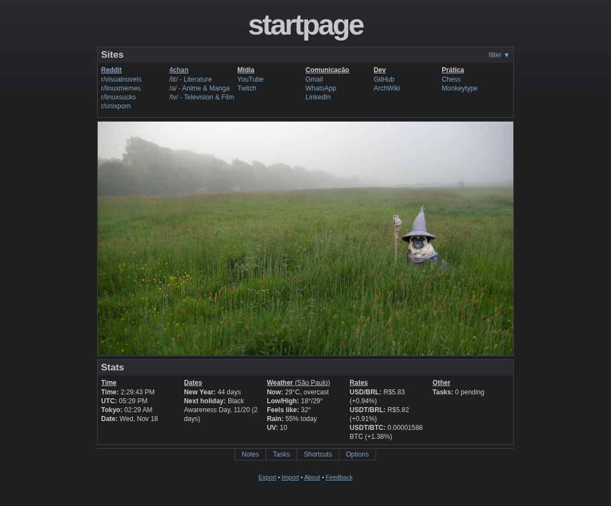
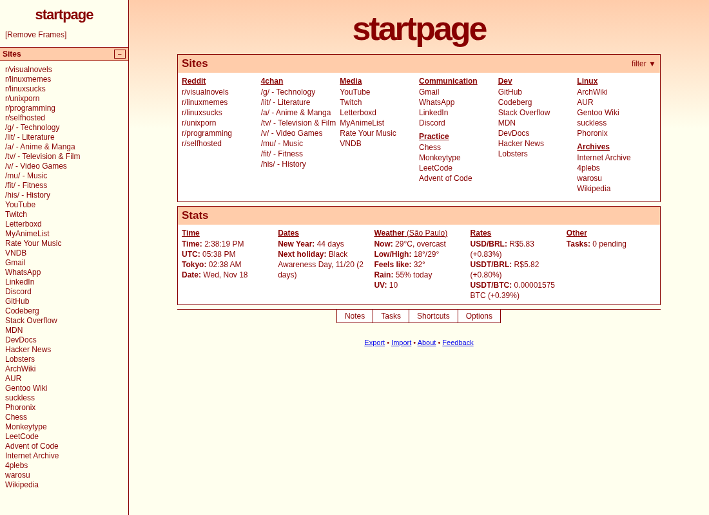
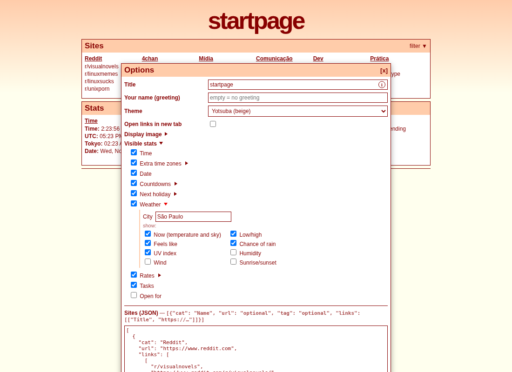

# startpage o/

A browser start page that looks like it wandered off a 2000s imageboard and decided to be useful.
One `index.html`, no build step, no server, no framework. Just open it and go.



## Themes

Three flavours, with or without a picture in the middle:

| Theme | Plain | With display image |
|---|---|---|
| Yotsuba |  |  |
| Yotsuba B |  |  |
| Dark |  |  |

## What it does

- **Sites** in tidy columns that stretch to fill the board. Edit them as JSON in Options.
- **Stats**: clock, extra time zones, countdowns, next public holiday, weather (pick what you care about: low/high, feels like, rain, UV, humidity, wind, sunrise/sunset) and currency rates, crypto included (`USDT/BRL`, `USDT/BTC`…).
- **Notes** and **Tasks** that save as you type.
- **filter ▼ → Use Frames** for an old-school sidebar with every link.
- **Options** in a draggable popup. Type `!blank` as the title if you want no title at all.
- Keyboard: `n` notes, `t` tasks, `o` options, `f` frames, `Esc` to back out.

| Frames | Options |
|---|---|
|  |  |

## Use it

Point your browser's home page at the file:

```
file:///path/to/startpage/index.html
```

- **Firefox:** Settings → Home → Homepage and new windows → Custom URLs.
- **Chrome:** Settings → On startup → Open a specific page.

Want it on every new tab too? You'll need an extension such as *New Tab Override*, since browsers won't let a local file be the new tab page on their own.

## Your data

Everything (settings, notes, tasks, the uploaded image) lives in your browser's `localStorage`. Nothing leaves your machine except the weather, rate and holiday lookups.
Moving the file, switching browsers or clearing site data starts you from scratch, so hit **Export** now and then and **Import** when you need it back.

## Thanks

- Weather: [Open-Meteo](https://open-meteo.com)
- Rates: [AwesomeAPI](https://docs.awesomeapi.com.br) and [CoinGecko](https://www.coingecko.com)
- Holidays: [Nager.Date](https://date.nager.at)
- Look: shamelessly inspired by 4chan's Yotsuba themes
- Screenshot image: wizard pug by Dave Henniker

Found a bug or have an idea? Open an [issue](https://github.com/olbaplegal/startpage/issues).
