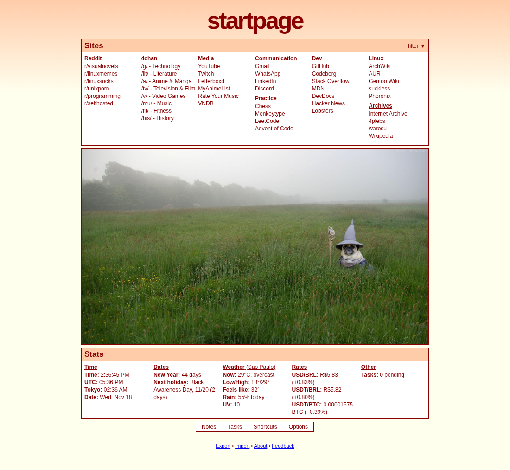
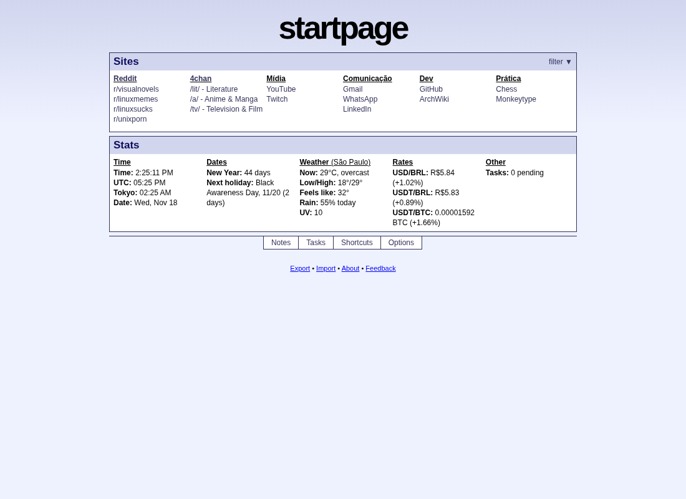
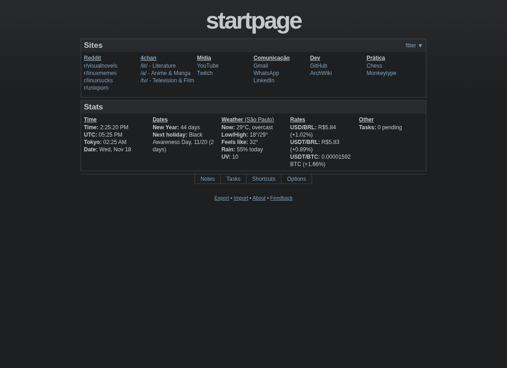

# startpage

I've been using 4chan quite frequently lately and really liked how comfortable and straightforward its homepage feels. So I decided to create a browser start page inspired by its design

It's a single `index.html`. Just link to your home page and be happy.


## Themes

| Theme | Without image | With image |
|---|---|---|
| Yotsuba |  |  |
| Yotsuba B |  |  |
| Dark |  |  |

## Features

- Links grouped by category, edited as JSON in Options. Columns adjust to the width.
- Stats: time, extra time zones, date, countdowns, next holiday, weather, currency rates (fiat and crypto), pending tasks.
- Weather fields are selectable: now, low/high, feels like, rain, UV, humidity, wind, sunrise/sunset.
- Notes and tasks, saved automatically.
- Optional image between Sites and Stats.
- Sidebar with all links (filter ▼ → Use Frames).
- Options open in a draggable popup. Title `!blank` hides the title.
- Shortcuts: `n` notes, `t` tasks, `o` options, `f` frames, `Esc` close.

| Frames | Options |
|---|---|
|  |  |

## Usage

Set the browser home page to:

```
file:///path/to/startpage/index.html
```

- Firefox: Settings → Home → Homepage and new windows → Custom URLs.
- Chrome: Settings → On startup → Open a specific page.

Browsers don't allow a local file as the new tab page; for that you need an extension like New Tab Override.

## Data

Settings, notes, tasks and the uploaded image are stored in the browser's `localStorage`. Moving the file, changing browsers or clearing site data resets everything, so use Export/Import to back up.

The only network requests are for weather, rates and holidays.

## Credits

- Weather: [Open-Meteo](https://open-meteo.com)
- Rates: [AwesomeAPI](https://docs.awesomeapi.com.br), [CoinGecko](https://www.coingecko.com)
- Holidays: [Nager.Date](https://date.nager.at)
- Design based on 4chan's Yotsuba themes
- Screenshot image: wizard pug by Dave Henniker

Bugs and ideas: [issues](https://github.com/olbaplegal/startpage/issues).
